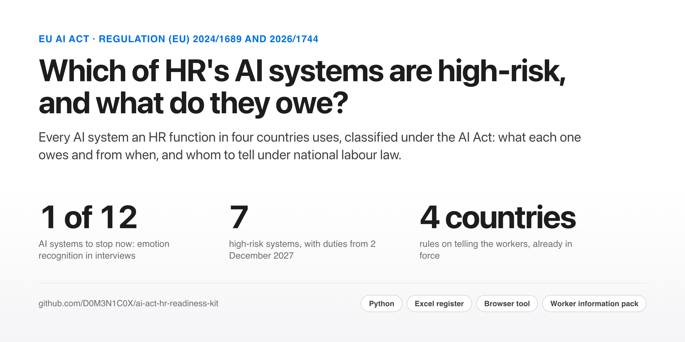
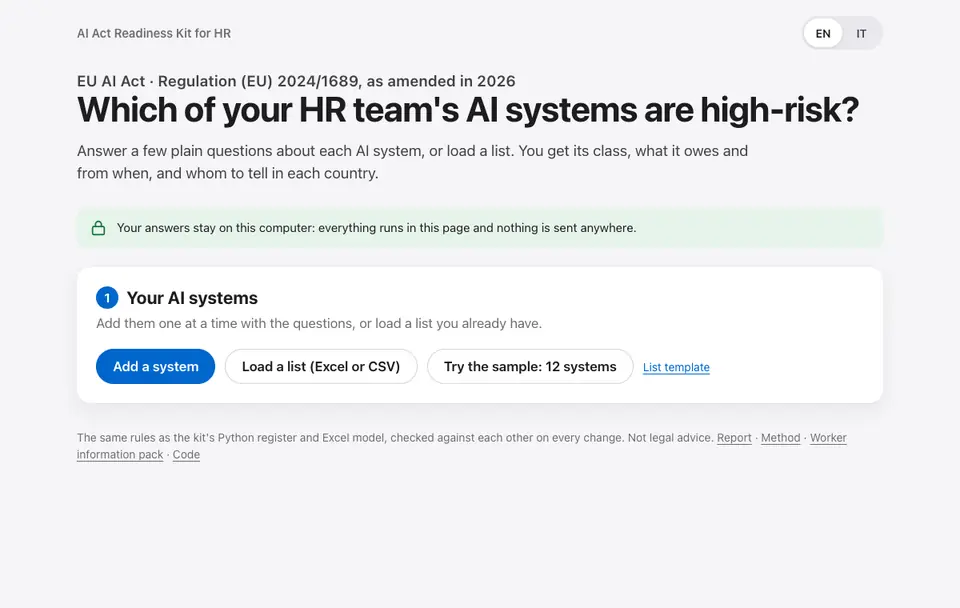
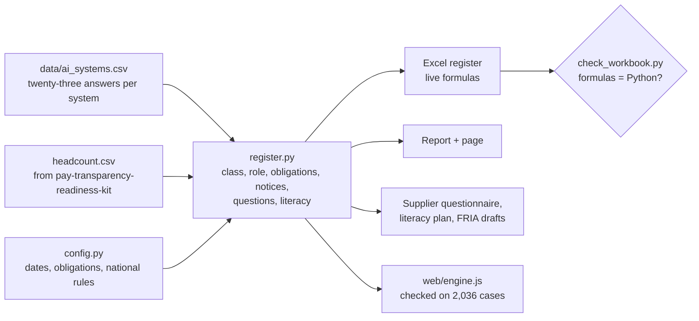

<picture>
  <source media="(prefers-color-scheme: dark)" srcset="site-assets/cover-dark.png">
  
</picture>

<p align="center">
  <a href="https://d0m3n1c0x.github.io/ai-act-hr-readiness-kit/tool/"><b>Check your own AI systems</b></a> ·
  <a href="https://d0m3n1c0x.github.io/ai-act-hr-readiness-kit/">Read the report</a> ·
  <a href="https://github.com/D0M3N1C0X/ai-act-hr-readiness-kit/raw/main/deliverables/ai_act_hr_register.xlsx">Excel register</a> ·
  <a href="docs/worker-information.md">Worker information pack</a>
</p>

<p align="center">
  <a href="https://github.com/D0M3N1C0X/ai-act-hr-readiness-kit/actions/workflows/ci.yml"></a>
  
  
</p>

## Why this matters

HR is where the EU AI Act reaches most employers first. Screening CVs, targeting job ads, scoring performance,
allocating shifts, proposing pay rises: Annex III puts all of them on the high-risk list. The Digital Omnibus
(Regulation (EU) 2026/1744) moved the high-risk duties to **2 December 2027**, but two things did not move. The bans
have applied since February 2025, and national labour law already decides whom an employer must tell before an AI
system is used on its workers.

This kit runs the exercise **as an HR advisory team would deliver it**, for the same employer in Italy, Poland,
Germany and Spain as [pay-transparency-readiness-kit](https://github.com/D0M3N1C0X/pay-transparency-readiness-kit):
an inventory of every AI system the HR function uses, the class of each one and why, what each owes and from when,
the notices each country requires, the questions to send each supplier, the AI literacy each system calls for, and a
fundamental rights impact assessment drafted for every high-risk system. The national rules cover nine countries, so
the [browser tool](https://d0m3n1c0x.github.io/ai-act-hr-readiness-kit/tool/) works for an employer in France, the
Netherlands, Ireland, Austria or Belgium too.

> **Synthetic systems, real law.** The organisation is the one in the pay transparency kit (3,443 workers); its twelve
> AI systems are invented to cover the cases an HR function meets. The AI Act and the Omnibus were read in the
> Official Journal, the national rules on the official legal databases or their open-data services, each with its
> status in the [verification register](docs/verification.md). Not legal advice.

## The answer, for the HR director

| | |
|---|---|
| **One system has to stop now.** A video interview pilot in Barcelona infers candidates' emotions from voice and face: prohibited at work since February 2025 (Art. 5(1)(f)), fines up to €35 million or 7% of turnover. | **Seven of twelve systems are high-risk**, from CV screening to the pay review recommender. The duties apply from **2 December 2027**, 404 days from this assessment; for systems already on the market, from their next significant design change (Art. 111(2)). |
| **The attrition model makes the employer a provider.** HR analytics put it into service for the employer's own use, so the provider's duties come with it: quality management, technical documentation, conformity assessment, registration (Art. 3(3) and 16). | **AI literacy applies already** to the staff using 11 systems (Art. 4, softened by the Omnibus). Telling people they are talking to an AI is the supplier's duty for 2 (Art. 50(1)); the employer checks it. |
| **Germany's works council is the constraint today**: 11 systems to inform it about, at least 5 that need its agreement before use (BetrVG §87(1) Nr. 6). | **Spain owes the works council the parameters of 7 systems; Italy, a written notice for 1 fully automated system** and a union agreement for a monitoring tool; Poland, two weeks' notice of monitoring. |
| **94 questions for the suppliers**, most of them for the six bought high-risk systems: the Article 13 instructions for use, accuracy by group, logs, and a warning before the design change that would end the Article 111(2) grace period. | **28 AI literacy modules to run** across the systems, from basics for every user to oversight training for the named overseers; the record shows the measures taken, as the Omnibus wording asks, not a level reached. |
| **No fundamental rights impact assessment is owed**: Article 27 binds public bodies and public-service providers, not a private employer. The kit drafts one for each of the 7 high-risk systems anyway, cross-referred to the DPIA as the Omnibus now allows (Art. 27(4)). | **A public employer running the same register** owes the assessment for every high-risk system, registers each use in the EU database (Art. 26(8)) and has until 2 August 2030 at the latest for systems already in use (Art. 111(2)). |

## Check your own systems

The same register runs in the browser. Say what kind of employer you are, answer plain questions about each AI system
("does it score or rank people?", "does it read emotions?"), or load the list you already have in Excel or CSV: each
system gets its class and the reason, the obligations with their dates, the national rules on telling the workers in
nine countries, the questions for its supplier and the literacy modules it calls for, with the fundamental rights
impact assessment where it is owed; the result downloads as an Excel workbook. English and Italian. **Nothing leaves
the computer.**

<p align="center"><a href="https://d0m3n1c0x.github.io/ai-act-hr-readiness-kit/tool/"></a></p>

## What you get

| Deliverable | For | What is in it |
|---|---|---|
| [`ai_act_hr_register.xlsx`](deliverables/ai_act_hr_register.xlsx) | the HR, legal and data protection team | Twelve sheets: the register with twenty-three answers per system and its class, the obligations each system triggers, the national rules on telling the workers, the questions for each supplier, the literacy modules, the fundamental rights impact assessment, a timeline, headcount, settings and a reconciliation sheet. **Every class, obligation, rule, question and module is a live formula**: change an answer, or the kind of employer, and the register follows. |
| [`ai_act_readiness.md`](reports/ai_act_readiness.md) · [online](https://d0m3n1c0x.github.io/ai-act-hr-readiness-kit/) | the HR director and the board | Answer first: the register, what applies when, the notices country by country, the boundary cases, the next 90 days. |
| [Browser tool](https://d0m3n1c0x.github.io/ai-act-hr-readiness-kit/tool/) | the HR business partner, on the client's own systems | Guided questions or a file; class, obligations and notices per system; an Excel download. Runs in the page. |
| [`supplier_questionnaire.md`](deliverables/supplier_questionnaire.md) | procurement and the system owners | The questions to send each system's supplier, with the article behind each, ready to send. |
| [`ai_literacy_plan.md`](deliverables/ai_literacy_plan.md) | HR learning and development | Six modules, for whom, what they cover, which systems call for each, and the evidence to keep. |
| [`fria_drafts.md`](deliverables/fria_drafts.md) | the DPO and HR | A fundamental rights impact assessment drafted for each high-risk system, pre-filled from the register and mapped to the DPIA. |
| [`worker-information.md`](docs/worker-information.md) | HR business partners and employee relations | Who to tell, when and what, in Italy, Germany, Spain, Poland, France, the Netherlands, Ireland, Austria and Belgium, with a model notice for each (in Italian for Italy). |
| [`docs/method.md`](docs/method.md) · [`docs/verification.md`](docs/verification.md) | reviewers | The classification rules and the choices the text leaves open; the source and status of every legal statement. |

## The judgement calls

- **Profiling closes the Article 6(3) door.** A system in Annex III that profiles people is high-risk whatever narrow
  task it claims; the interview scheduler escapes only because it ranks no one.
- **Building it yourself makes you the provider.** The in-house attrition model is the register's heaviest item
  (Art. 3(3) and 16); the report sets out the three ways out.
- **Already on the market is not a free pass.** Article 111(2) spares a system whose type and model was on the market
  before December 2027 until its design changes significantly; cloud HR software changes often, so the register keeps
  the duties on the list and dates each system's trigger.
- **Boundary cases are named, not hidden.** Shift scheduling is high-risk because it uses past attendance; without it,
  it might not be. Learning recommendations are minimal only while they do not feed promotion or pay.
- **The right to an explanation is dated with the high-risk duties.** Article 86 applies from August 2026, but it
  attaches to a classification that applies from December 2027; the reading is flagged.
- **A prohibited system is stopped, not notified.** It triggers no information duty: the notices are for systems that
  stay.
- **An assessment nobody asked for.** A private employer owes no fundamental rights impact assessment; the kit drafts
  one for each high-risk system because a works council, a data protection authority or a court asks the same
  questions.
- **Nine countries, read conservatively.** Whether an HR AI system is a *nouvelle technologie* in France, an
  *important* technological facility in the Netherlands, or touches human dignity in Austria is a judgement; the
  register assumes yes where the system monitors or changes work, and says so.

## Built to be checked

| | |
|---|---|
| **Three engines, one answer** | Python and the workbook's live formulas, reconciled on 813 checks and recalculated in CI by LibreOffice; the browser tool checked against Python on 16,309 values from the twelve systems under each kind of employer and 2,000 random ones; tests change an answer, or the kind of employer, and check the workbook follows |
| **Law read in the original** | the Official Journal for the AI Act, the Omnibus and the GDPR; normattiva, gesetze-im-internet and the BOE for the Italian, German and Spanish rules; the Dutch and Austrian governments' open-data services, the Irish Statute Book, the National Labour Council in Belgium and the Ministry of Labour's official code in France (the Polish rules through secondary sources); a [verification register](docs/verification.md) with the status of each |
| **Reproducible** | one command rebuilds every output; CI fails if a rebuilt file differs from the committed one |

<details>
<summary><b>For engineers: how it fits together, how to run it</b></summary>



```bash
python3 -m venv .venv && . .venv/bin/activate
pip install -r requirements-dev.txt
python src/run_all.py        # under a second
pytest                       # includes the workbook calculated in pure Python
```

```
├── data/ai_systems.csv          the twelve systems and the twenty-three answers that classify them
├── data/source/headcount.csv    workers by employer and department (pay-transparency-readiness-kit)
├── src/
│   ├── config.py                dates, obligations, national rules, supplier questions, literacy
│   │                            modules and the FRIA elements, each with its source
│   ├── register.py              classification, role, obligations, notices
│   ├── build_workbook.py        the Excel register and its reconciliation sheet
│   ├── check_workbook.py        proves the formulas reproduce Python
│   ├── build_report.py          the report and its page
│   ├── build_deliverables.py    supplier questionnaire, literacy plan, FRIA drafts
│   ├── build_web.py             the tool's inputs and the cases its JavaScript is checked on
│   └── run_all.py               the whole pipeline
├── deliverables/                the workbook and the three working documents
├── reports/                     the report and its HTML page
├── web/                         the browser tool (engine.js mirrors register.py)
└── docs/                        method, verification register, worker information pack
```

</details>

## About

Built by **Domenico Perroni**: HR advisory for the Italian market, people analytics and reward, based in Kraków.
[GitHub](https://github.com/D0M3N1C0X) · [LinkedIn](https://www.linkedin.com/in/domenico-perroni) · [Portfolio](https://d0m3n1c0x.github.io/)

**More from the same portfolio**

- [pay-transparency-readiness-kit](https://github.com/D0M3N1C0X/pay-transparency-readiness-kit) — the EU Pay Transparency Directive for the same employer: a live Excel model reconciled with pandas, a board briefing and a browser tool on the client's payroll
- [equal-value-pay-ranges](https://github.com/D0M3N1C0X/equal-value-pay-ranges) — one pay range per grade and country for the same organisation, priced on Eurostat market data
- [workforce-cost-model](https://github.com/D0M3N1C0X/workforce-cost-model) — the same organisation's people budget: FY2026 variance and FY2027 scenarios
- [hr-people-analytics](https://github.com/D0M3N1C0X/hr-people-analytics) — attrition drivers and pay equity on the same synthetic organisation, where the attrition model in this register comes from

MIT licensed. Reuse anything here.
