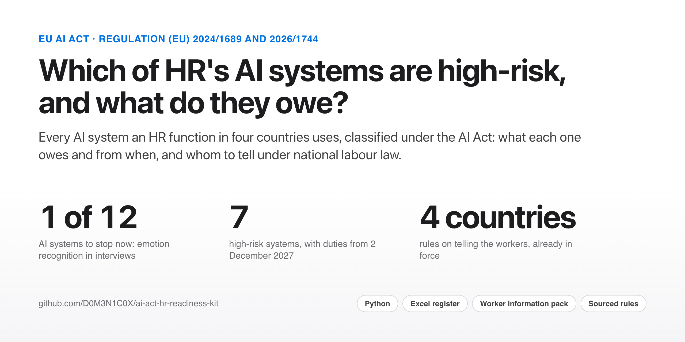
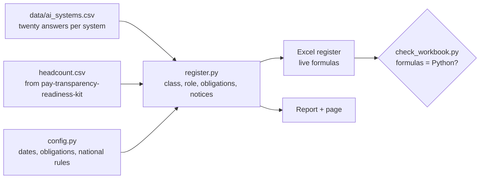

<picture>
  <source media="(prefers-color-scheme: dark)" srcset="site-assets/cover-dark.png">
  
</picture>

<p align="center">
  <a href="https://d0m3n1c0x.github.io/ai-act-hr-readiness-kit/"><b>Read the report</b></a> ·
  <a href="https://github.com/D0M3N1C0X/ai-act-hr-readiness-kit/raw/main/deliverables/ai_act_hr_register.xlsx">Excel register</a> ·
  <a href="docs/worker-information.md">Worker information pack</a>
</p>

<p align="center">
  <a href="https://github.com/D0M3N1C0X/ai-act-hr-readiness-kit/actions/workflows/ci.yml"></a>
  
  
</p>

## Why this matters

HR is where the EU AI Act reaches most employers first. Screening CVs, targeting job ads, scoring performance,
allocating shifts, proposing pay rises: Annex III puts all of them on the high-risk list. The Digital Omnibus
(Regulation (EU) 2026/1744) moved the high-risk duties to **2 December 2027**, but two things did not move. The bans
have applied since February 2025, and national labour law already decides whom an employer must tell before an AI
system is used on its workers.

This kit runs the exercise **as an HR advisory team would deliver it**, for the same employer in Italy, Poland,
Germany and Spain as [pay-transparency-readiness-kit](https://github.com/D0M3N1C0X/pay-transparency-readiness-kit):
an inventory of every AI system the HR function uses, the class of each one and why, what each owes and from when,
and the notices each country requires.

> **Synthetic systems, real law.** The organisation is the one in the pay transparency kit (3,443 workers); its twelve
> AI systems are invented to cover the cases an HR function meets. The AI Act and the Omnibus were read in the
> Official Journal, the national rules on the official legal databases, each with its status in the
> [verification register](docs/verification.md). Not legal advice.

## The answer, for the HR director

| | |
|---|---|
| **One system has to stop now.** A video interview pilot in Barcelona infers candidates' emotions from voice and face: prohibited at work since February 2025 (Art. 5(1)(f)), fines up to €35 million or 7% of turnover. | **Seven of twelve systems are high-risk**, from CV screening to the pay review recommender. Their duties start on **2 December 2027**, 404 days from this assessment. |
| **The attrition model makes the employer a provider.** HR analytics built it, so the provider's duties come with it: quality management, technical documentation, conformity assessment, registration (Art. 16 and 25). | **Two duties apply already**: AI literacy for the staff using 11 systems (Art. 4, softened by the Omnibus) and telling people they are talking to an AI for 2 (Art. 50(1)). |
| **Germany's works council is the constraint today**: 8 systems to inform it about, 5 that need its agreement before use (BetrVG §87(1) Nr. 6). | **Spain owes the works council the parameters of 7 systems; Italy, notices for 2 fully automated systems** and a union agreement for a monitoring tool; Poland, two weeks' notice of monitoring. |

## What you get

| Deliverable | For | What is in it |
|---|---|---|
| [`ai_act_hr_register.xlsx`](deliverables/ai_act_hr_register.xlsx) | the HR, legal and data protection team | Nine sheets: the register with twenty answers per system and its class, the obligations each system triggers, the national rules on telling the workers, a timeline, headcount, settings and a reconciliation sheet. **Every class and obligation is a live formula**: change an answer and the system is reclassified. |
| [`ai_act_readiness.md`](reports/ai_act_readiness.md) · [online](https://d0m3n1c0x.github.io/ai-act-hr-readiness-kit/) | the HR director and the board | Answer first: the register, what applies when, the notices country by country, the boundary cases, the next 90 days. |
| [`worker-information.md`](docs/worker-information.md) | HR business partners and employee relations | Who to tell, when and what, in Italy, Germany, Spain and Poland, with a model notice for each (in Italian for Italy). |
| [`docs/method.md`](docs/method.md) · [`docs/verification.md`](docs/verification.md) | reviewers | The classification rules and the choices the text leaves open; the source and status of every legal statement. |

## The judgement calls

- **Profiling closes the Article 6(3) door.** A system in Annex III that profiles people is high-risk whatever narrow
  task it claims; the interview scheduler escapes only because it ranks no one.
- **Building it yourself makes you the provider.** The in-house attrition model is the register's heaviest item; the
  report sets out the three ways out.
- **Boundary cases are named, not hidden.** Shift scheduling is high-risk because it uses past attendance; without it,
  it might not be. Learning recommendations are minimal only while they do not feed promotion or pay.
- **The right to an explanation is dated with the high-risk duties.** Article 86 applies from August 2026, but it
  attaches to a classification that applies from December 2027; the reading is flagged.
- **A prohibited system is stopped, not notified.** It triggers no information duty: the notices are for systems that
  stay.

## Built to be checked

| | |
|---|---|
| **Two engines, one answer** | Python and the workbook's live formulas, reconciled on 317 checks and recalculated in CI by LibreOffice; a test changes an answer and checks that both engines reclassify the system |
| **Law read in the original** | the Official Journal for the AI Act and the Omnibus; normattiva, gesetze-im-internet and the BOE for the national rules; a [verification register](docs/verification.md) with the status of each |
| **Reproducible** | one command rebuilds every output; CI fails if a rebuilt file differs from the committed one |

<details>
<summary><b>For engineers: how it fits together, how to run it</b></summary>



```bash
python3 -m venv .venv && . .venv/bin/activate
pip install -r requirements-dev.txt
python src/run_all.py        # under a second
pytest                       # includes the workbook calculated in pure Python
```

```
├── data/ai_systems.csv          the twelve systems and the answers that classify them
├── data/source/headcount.csv    workers by employer and department (pay-transparency-readiness-kit)
├── src/
│   ├── config.py                dates, obligations, national rules, each with its source
│   ├── register.py              classification, role, obligations, notices
│   ├── build_workbook.py        the Excel register and its reconciliation sheet
│   ├── check_workbook.py        proves the formulas reproduce Python
│   ├── build_report.py          the report and its page
│   └── run_all.py               the whole pipeline
├── deliverables/                the workbook
├── reports/                     the report and its HTML page
└── docs/                        method, verification register, worker information pack
```

</details>

## About

Built by **Domenico Perroni**: HR advisory for the Italian market, people analytics and reward, based in Kraków.
[GitHub](https://github.com/D0M3N1C0X) · [LinkedIn](https://www.linkedin.com/in/domenico-perroni) · [Portfolio](https://d0m3n1c0x.github.io/)

**More from the same portfolio**

- [pay-transparency-readiness-kit](https://github.com/D0M3N1C0X/pay-transparency-readiness-kit) — the EU Pay Transparency Directive for the same employer: a live Excel model reconciled with pandas, a board briefing and a browser tool on the client's payroll
- [equal-value-pay-ranges](https://github.com/D0M3N1C0X/equal-value-pay-ranges) — one pay range per grade and country for the same organisation, priced on Eurostat market data
- [workforce-cost-model](https://github.com/D0M3N1C0X/workforce-cost-model) — the same organisation's people budget: FY2026 variance and FY2027 scenarios
- [hr-people-analytics](https://github.com/D0M3N1C0X/hr-people-analytics) — attrition drivers and pay equity on the same synthetic organisation, where the attrition model in this register comes from

MIT licensed. Reuse anything here.
